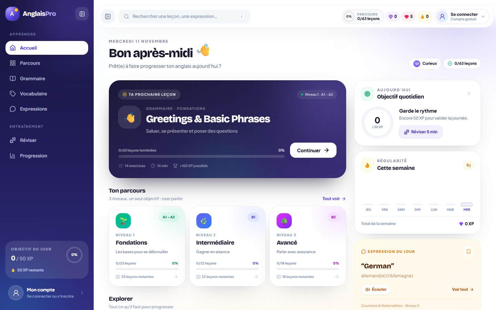
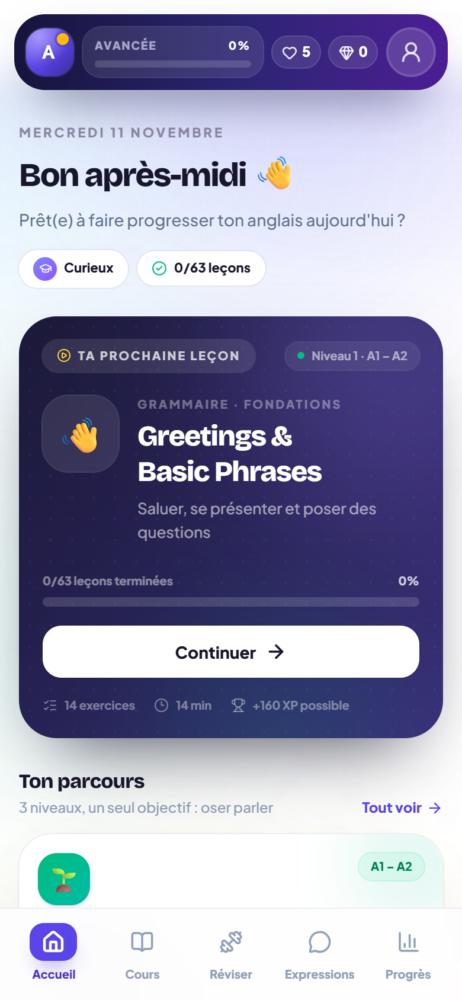

# Anglais Pro

> Apprendre l'anglais, 5 minutes par jour — cours, exercices, expressions et grammaire, du niveau A1 au B2.

Une application web **mobile-first** pensée pour les francophones qui veulent progresser en anglais sans s'ennuyer. Leçons courtes, exercices variés, révision intelligente et suivi de progression : tout est là pour installer une vraie habitude.



<p align="center">
  
</p>

<p>
  
  
  
  
  
</p>

---

## 💎 Fonctionnalités

- **Parcours structuré en 3 niveaux** — Fondations (A1–A2), Intermédiaire (B1), Avancé (B2).
- **63 leçons complètes** — chaque leçon combine théorie claire (encadrés, tableaux, phrases clés) et quiz interactif.
- **4 types d'exercices** — choix multiple, saisie de texte, reconstruction de phrases par tuiles et association de paires.
- **Bibliothèque filtrable** — recherche instantanée, filtres par niveau, catégorie et statut (à faire / terminé / favoris).
- **Grammaire & vocabulaire** — 17 fiches de grammaire et 14 thèmes de vocabulaire, consultables hors leçon.
- **910 expressions utiles** — avec traduction, note d'usage et écoute audio.
- **Révision ciblée** — sessions par compétence, marathon de 20 questions et flashcards.
- **Progression motivante** — XP, cœurs, série quotidienne, objectif journalier, rangs et succès.
- **Audio intégré** — prononciation via la synthèse vocale du navigateur (activable/désactivable).
- **Mobile d'abord** — barre haute arrondie, navigation basse sur téléphone, sidebar repliable sur ordinateur.
- **Compte utilisateur** — inscription email / mot de passe ou Google, photo de profil, session sécurisée.
- **Progression synchronisée** — Neon Postgres conserve XP, cœurs, série, leçons et favoris entre appareils.
- **Mode invité complet** — on commence à apprendre immédiatement, puis on crée son compte quand on veut, sans rien perdre.

## 📚 Contenu

| Niveau | Nom | Référence CECRL | Leçons | Exercices |
| :----: | --- | :-------------: | -----: | --------: |
| 1 | Fondations | A1 – A2 | 23 | 301 |
| 2 | Intermédiaire | B1 | 22 | 250 |
| 3 | Avancé | B2 | 18 | 221 |
| **Total** | | | **63** | **772** |

- **910 expressions** prêtes à l'emploi
- **452 lignes de vocabulaire** réparties en 14 thèmes
- **17 fiches de grammaire** et **3 leçons de lecture**

## 🧱 Stack technique

| Rôle | Technologie |
| --- | --- |
| UI | [React 19](https://react.dev) + TypeScript |
| Build | [Vite 8](https://vite.dev) |
| Styles | [Tailwind CSS 4](https://tailwindcss.com) (thème personnalisé, composants utilitaires) |
| Navigation | [React Router 7](https://reactrouter.com) — `HashRouter` compatible hébergement statique |
| État global | [Zustand 5](https://zustand-demo.pmnd.rs) + `persist` (localStorage) |
| Base de données | [Neon Postgres](https://neon.tech) via l'intégration Vercel |
| API | Fonctions serverless Vercel (`/api`) — sessions HttpOnly, mots de passe scrypt |
| Authentification | Email / mot de passe + Google OAuth 2.0 |
| Icônes | [Lucide](https://lucide.dev) |
| Effets | [canvas-confetti](https://github.com/catdad/canvas-confetti) |

## 🔐 Comptes et base de données

L'application fonctionne **sans compte**. Dès la première leçon, une invitation discrète propose de créer un compte pour synchroniser la progression.

- **Inscription email** : mot de passe haché avec `scrypt`, session dans un cookie `HttpOnly` / `SameSite=Lax` de 30 jours.
- **Google** : active le fournisseur en renseignant `GOOGLE_CLIENT_ID` et `GOOGLE_CLIENT_SECRET` sur Vercel, avec l'URI de redirection `https://<domaine>/api/auth/google/callback`.
- **Photo** : redimensionnée et compressée en 256×256 dans le navigateur, puis stockée dans Postgres.
- **Progression** : fusionnée à la connexion (aucune perte des données invité), puis synchronisée avec un debounce.
- **Tables créées automatiquement** au premier appel : `users`, `sessions`, `progress`.

Variables d'environnement : voir [`.env.example`](.env.example). Sur Vercel, l'intégration Neon fournit `DATABASE_URL` automatiquement.

## 🚀 Démarrage

Prérequis : **Node.js 22+** et npm.

```bash
# 1. Installer les dépendances
npm install

# 2. Lancer le serveur de développement
npm run dev
# → http://localhost:5173

# 3. Construire la version de production
npm run build
npm run preview
```

## 📜 Scripts

| Commande | Description |
| --- | --- |
| `npm run dev` | Serveur de développement avec HMR |
| `npm run build` | Vérification TypeScript + build de production dans `dist/` |
| `npm run preview` | Sert localement le build de production |
| `npm run typecheck` | Vérification des types seule |

## 🗂 Architecture

Organisation **par fonctionnalité** : chaque domaine possède ses pages et sa logique, le reste est partagé.

```
anglais-pro/
├─ content/                 # Données pédagogiques (JSON, source de vérité)
│  ├─ level-1.json
│  ├─ level-2.json
│  └─ level-3.json
├─ api/                     # Fonctions serverless Vercel
│  ├─ auth/                 # signup, login, logout, me, Google OAuth
│  ├─ profile.js            # Nom + photo
│  ├─ progress.js           # Synchronisation de la progression
│  └─ _lib/                 # Connexion Neon, sessions, utilitaires HTTP
├─ public/                  # Favicon, icône, manifest PWA
├─ src/
│  ├─ auth/                 # AuthProvider (session, fusion et sync)
│  ├─ components/           # UI partagée (shell, avatar, menus, boutons…)
│  ├─ data/
│  │  └─ curriculum.ts      # Agrégation, index et sélecteurs du contenu
│  ├─ features/
│  │  ├─ home/              # Tableau de bord
│  │  ├─ learn/             # Parcours
│  │  ├─ library/           # Bibliothèque de leçons (recherche + filtres)
│  │  ├─ grammar/           # Fiches de grammaire
│  │  ├─ vocabulary/        # Thèmes de vocabulaire
│  │  ├─ expressions/       # Expressions et favoris
│  │  ├─ practice/          # Révision, sessions, flashcards
│  │  ├─ lesson/            # Leçon + moteur de quiz
│  │  ├─ auth/              # Connexion / inscription
│  │  ├─ profile/           # Profil et photo
│  │  └─ progress/          # Statistiques et succès
│  ├─ lib/                  # Utilitaires, API, audio, succès, catégories
│  ├─ store/                # État persistant (XP, cœurs, série…)
│  ├─ types.ts              # Modèle de données typé
│  ├─ App.tsx               # Routes
│  └─ index.css             # Design system Tailwind
├─ .github/workflows/       # Déploiement GitHub Pages (site statique)
├─ vercel.json              # Build Vite + fonctions API
└─ vite.config.ts
```

## 🧭 Routes

| Route | Page |
| --- | --- |
| `/` | Accueil / tableau de bord |
| `/learn` | Parcours par niveau |
| `/grammar` | Bibliothèque de grammaire |
| `/vocabulary` | Thèmes de vocabulaire |
| `/expressions` | Expressions et favoris |
| `/practice` | Choix du mode de révision |
| `/practice/session/:mode` | Session d'exercices |
| `/practice/flashcards` | Flashcards |
| `/lesson/:unitId` | Leçon (théorie + quiz) |
| `/progress` | Progression, succès et rangs |

## 🗃 Modèle de données

Le contenu vit dans `content/*.json`. Chaque fichier est un tableau de leçons :

```ts
interface Unit {
  id: string;
  cat: "grammar" | "vocabulary" | "expressions" | "reading";
  title: string;
  subtitle: string;
  emoji: string;
  theory: TheoryBlock[];  // paragraphes, titres, tableaux, phrases, astuces
  quiz: QuizQuestion[];   // choice | tiles | type | match
}
```

`src/data/curriculum.ts` enrichit ces unités avec leur niveau, puis expose des index prêts à l'emploi (`CURRICULUM`, `ALL_QUESTIONS`, `PHRASES`) et des sélecteurs pour les modes de révision.

## 🎨 Design system

- Palette principale violette (`brand`), accents vert/ambre/rose pour les catégories.
- Typographies **Bricolage Grotesque** (titres) et **Plus Jakarta Sans** (texte).
- Composants utilitaires dans `src/index.css` : `.card`, `.btn`, `.glass`, `.eyebrow`, `.safe-bottom`…
- Animations douces (`fade-up`, `float`, transitions) et respect de `prefers-reduced-motion`.
- Cibles tactiles ≥ 44 px, navigation basse sécurisée pour les encoches (`safe-area-inset`).

## 🌐 Déploiement

### Vercel (version complète, avec comptes)

**Production : [anglais-pro.vercel.app](https://anglais-pro.vercel.app)**

Le projet est relié au dépôt GitHub : chaque push sur `main` déclenche un déploiement de production, et l'intégration Neon fournit la base Postgres.

1. Importer le dépôt dans Vercel (framework **Vite** détecté automatiquement).
2. Ajouter l'intégration **Neon** (elle renseigne `DATABASE_URL`).
3. Renseigner éventuellement `GOOGLE_CLIENT_ID` / `GOOGLE_CLIENT_SECRET` pour activer Google.
4. Les tables `users`, `sessions` et `progress` sont créées au premier appel API.

Les préversions restent protégées par Vercel Authentication ; seule la production est publique.

### GitHub Pages (version statique)

Le projet est aussi prêt pour **GitHub Pages** via GitHub Actions (`.github/workflows/deploy.yml`) :

1. Pousser le dépôt sur GitHub (branche `main`).
2. Dans **Settings → Pages**, choisir **Source : GitHub Actions**.
3. Chaque push sur `main` construit et publie automatiquement l'application.

Le build utilise `base: "./"` et un `HashRouter` : il fonctionne aussi bien à la racine d'un domaine que dans un sous-dossier, sans configuration serveur.

> Sur GitHub Pages, il n'y a pas de fonctions serverless : l'application reste pleinement utilisable en **mode invité** (progression locale) et l'interface indique que les comptes sont disponibles sur Vercel.

## 📄 Licence

Projet pédagogique — code sous licence **MIT**. Le contenu des leçons est fourni à titre d'exemple et peut être adapté librement.
