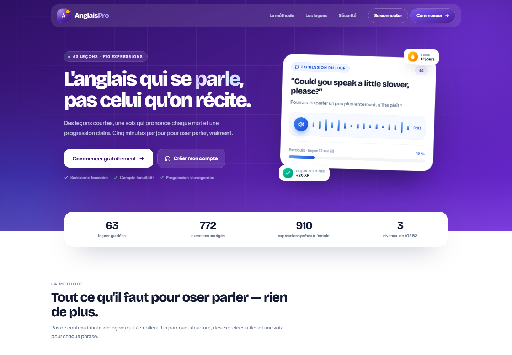

# Anglais Pro

> Apprendre l'anglais, 5 minutes par jour — cours, exercices, expressions et grammaire, du niveau A1 au B2.

Une application web **mobile-first** pensée pour les francophones qui veulent progresser en anglais sans s'ennuyer. Leçons courtes, exercices variés, révision intelligente et suivi de progression : tout est là pour installer une vraie habitude.



<p align="center">
  
</p>

<p>
  
  
  
  
  
</p>

---

## 💎 Fonctionnalités

- **Parcours structuré en 3 niveaux** — Fondations (A1–A2), Intermédiaire (B1), Avancé (B2).
- **63 leçons complètes** — chaque leçon combine théorie claire (encadrés, tableaux, phrases clés) et quiz interactif.
- **4 types d'exercices** — choix multiple, saisie de texte, reconstruction de phrases par tuiles et association de paires.
- **Bibliothèque filtrable** — recherche instantanée, filtres par niveau, catégorie et statut (à faire / terminé / favoris).
- **Recherche globale** — la barre haute (ou les raccourcis `/` et Ctrl/Cmd + K) ouvre un dictionnaire : on tape un mot (anglais ou français), l'app affiche son sens, un exemple, l'écoute audio et la leçon qui le contient.
- **Grammaire & vocabulaire** — 17 fiches de grammaire et 14 thèmes de vocabulaire, consultables hors leçon.
- **910 expressions utiles** — avec traduction, note d'usage et écoute audio.
- **Révision ciblée** — sessions par compétence, marathon de 20 questions et flashcards.
- **Progression motivante** — XP, cœurs qui se gagnent en terminant des leçons (3 maximum), série quotidienne, objectif journalier, rangs et succès. La barre supérieure met en avant les points, la série de jours, le pourcentage d'avancement et le profil, sans icône cœur.
- **Page de présentation** — un landing page moderne (dégradés violet/bleu, aperçu de leçon animé, apparitions au défilement) accueille les nouveaux visiteurs avant l'application.
- **Audio intégré** — prononciation via la synthèse vocale du navigateur : la voix la plus naturelle disponible (Natural/Neural/Google/Samantha) est choisie automatiquement, le texte est découpé aux fins de phrase pour respecter la ponctuation, et un égaliseur animé accompagne l'écoute.
- **Animations réelles** — apparitions en cascade, survols qui soulèvent les cartes, mascottes qui flottent, barres qui poussent, égaliseur de lecture et révélations au défilement sur la page de présentation ; tout se réduit depuis les Réglages ou le réglage système.
- **Réglages centralisés** — une page `/reglages` regroupe l'apparence (clair, sombre ou système), la réduction des animations, la prononciation vocale, l'objectif quotidien, la série, le compte et la réinitialisation.
- **Mode nuit complet** — thème sombre appliqué par variables CSS sur toute l'application, mémorisé sur l'appareil et sans clignotement au chargement ; la page de présentation reste volontairement en clair.
- **Sécurité renforcée** — sessions HttpOnly 14 jours, isolation par `user_id`, RLS et privilèges retirés sur les tables, limitation des tentatives et en-têtes stricts.
- **Coachs illustrés** — quatre personnages animés (Mia, Leo, Zoé et Sam) accompagnent les expressions, le vocabulaire et les conseils avec des bulles d'explication.
- **Mobile d'abord** — barre haute arrondie qui reste collée en haut pendant le défilement, sidebar unique qui se referme en rail d'icônes (tiroir animé sur mobile, panneau fixe sur ordinateur).
- **Compte utilisateur** — inscription email / mot de passe ou Google, photo de profil, session sécurisée.
- **Progression sauvegardée** — une base Postgres conserve XP, cœurs, série, leçons et favoris entre appareils.
- **Mode invité complet** — on commence à apprendre immédiatement, puis on crée son compte quand on veut, sans rien perdre.

## 📚 Contenu

| Niveau | Nom | Référence CECRL | Leçons | Exercices |
| :----: | --- | :-------------: | -----: | --------: |
| 1 | Fondations | A1 – A2 | 23 | 301 |
| 2 | Intermédiaire | B1 | 22 | 250 |
| 3 | Avancé | B2 | 18 | 221 |
| **Total** | | | **63** | **772** |

- **910 expressions** prêtes à l'emploi
- **452 lignes de vocabulaire** réparties en 14 thèmes
- **17 fiches de grammaire** et **3 leçons de lecture**

## 🧱 Stack technique

| Rôle | Technologie |
| --- | --- |
| UI | [React 19](https://react.dev) + TypeScript |
| Build | [Vite 8](https://vite.dev) |
| Styles | [Tailwind CSS 4](https://tailwindcss.com) (thème personnalisé, composants utilitaires) |
| Navigation | [React Router 7](https://reactrouter.com) — `HashRouter` compatible hébergement statique |
| État global | [Zustand 5](https://zustand-demo.pmnd.rs) + `persist` (localStorage) |
| Base de données | [Neon Postgres](https://neon.tech) via l'intégration Vercel |
| API | Fonctions serverless Vercel (`/api`) — sessions HttpOnly, mots de passe scrypt |
| Authentification | Email / mot de passe + Google OAuth 2.0 |
| Icônes | [Material Symbols Rounded](https://fonts.google.com/icons) (navigation et réglages) + [Lucide](https://lucide.dev) (contenu) |
| Effets | [canvas-confetti](https://github.com/catdad/canvas-confetti) |

## 🔐 Comptes et base de données

L'application fonctionne **sans compte**. Dès la première leçon, une invitation discrète propose de créer un compte pour synchroniser la progression.

- **Inscription email** : mot de passe haché avec `scrypt`, session dans un cookie `HttpOnly` / `SameSite=Lax` de 14 jours, plafonnée à 10 sessions actives par compte.
- **Google** : active le fournisseur en renseignant `GOOGLE_CLIENT_ID` et `GOOGLE_CLIENT_SECRET` sur Vercel, avec l'URI de redirection `https://<domaine>/api/auth/google/callback`. Le flux utilise PKCE (S256) et un cookie `state` à usage unique.
- **Photo** : redimensionnée et compressée en 256×256 dans le navigateur, puis stockée dans Postgres.
- **Progression** : fusionnée à la connexion (aucune perte des données invité), puis synchronisée avec un debounce.
- **Tables créées automatiquement** au premier appel : `users`, `sessions`, `progress`.

### Défense en profondeur

| Couche | Mesure |
| --- | --- |
| Base de données | RLS activé sur `users`, `sessions` et `progress`, aucune politique permissive : seul le rôle propriétaire (l'API) peut lire. `PUBLIC` et les rôles `anon` / `authenticated` sont révoqués. Les contraintes vérifient l'email en minuscules, la longueur des jetons et la forme JSON de la progression. |
| Requêtes | Chaque lecture/écriture est filtrée par `user_id` issu de la session serveur — aucun identifiant utilisateur n'est accepté depuis le client. |
| Sessions | Jeton aléatoire de 32 octets, stocké uniquement sous forme de hash SHA-256, cookie `HttpOnly`, `Secure`, `SameSite=Lax`, expiration 14 jours et purge opportuniste. |
| Mots de passe | `scrypt` (N=16384, r=8, p=1), sel aléatoire, comparaison à temps constant, hash factice pour les emails inconnus (anti-énumération). |
| Écritures | Vérification d'origine (CSRF), limitation par IP et par compte, corps limité à 1 Mo, état de progression assaini et borné. |
| Navigateur | CSP stricte, HSTS, `nosniff`, `X-Frame-Options: DENY`, `frame-ancestors 'none'`, COOP/CORP, `Referrer-Policy`, permissions désactivées. |

Le fichier `api/_lib/db.js` applique automatiquement le durcissement si la connexion est propriétaire des tables ; sinon il l'ignore pour ne jamais bloquer l'application, l'isolation applicative restant active.

Variables d'environnement : voir [`.env.example`](.env.example). Sur Vercel, l'intégration Neon fournit `DATABASE_URL` automatiquement.

## 🚀 Démarrage

Prérequis : **Node.js 22+** et npm.

```bash
# 1. Installer les dépendances
npm install

# 2. Lancer le serveur de développement
npm run dev
# → http://localhost:5173

# 3. Construire la version de production
npm run build
npm run preview
```

## 📜 Scripts

| Commande | Description |
| --- | --- |
| `npm run dev` | Serveur de développement avec HMR |
| `npm run build` | Vérification TypeScript + build de production dans `dist/` |
| `npm run preview` | Sert localement le build de production |
| `npm run typecheck` | Vérification des types seule |

## 🗂 Architecture

Organisation **par fonctionnalité** : chaque domaine possède ses pages et sa logique, le reste est partagé.

```
anglais-pro/
├─ content/                 # Données pédagogiques (JSON, source de vérité)
│  ├─ level-1.json
│  ├─ level-2.json
│  └─ level-3.json
├─ api/                     # Fonctions serverless Vercel
│  ├─ auth/                 # signup, login, logout, me, Google OAuth
│  ├─ profile.js            # Nom + photo
│  ├─ progress.js           # Synchronisation de la progression
│  └─ _lib/                 # Connexion Neon, sessions, utilitaires HTTP
├─ public/                  # Favicon, icône, manifest PWA
├─ src/
│  ├─ auth/                 # AuthProvider (session, fusion et sync)
│  ├─ components/           # UI partagée (shell, avatar, menus, boutons…)
│  ├─ data/
│  │  └─ curriculum.ts      # Agrégation, index et sélecteurs du contenu
│  ├─ features/
│  │  ├─ landing/           # Page de présentation (avant l'application)
│  │  ├─ home/              # Tableau de bord
│  │  ├─ learn/             # Parcours
│  │  ├─ library/           # Bibliothèque de leçons (recherche + filtres)
│  │  ├─ grammar/           # Fiches de grammaire
│  │  ├─ vocabulary/        # Thèmes de vocabulaire
│  │  ├─ expressions/       # Expressions et favoris
│  │  ├─ practice/          # Révision, sessions, flashcards
│  │  ├─ lesson/            # Leçon + moteur de quiz
│  │  ├─ auth/              # Connexion / inscription
│  │  ├─ profile/           # Profil et photo
│  │  ├─ settings/          # Réglages (thème, audio, objectif…)
│  │  └─ progress/          # Statistiques et succès
│  ├─ lib/                  # Utilitaires, API, audio, succès, catégories
│  ├─ store/                # État persistant (progression + réglages)
│  ├─ types.ts              # Modèle de données typé
│  ├─ App.tsx               # Routes
│  └─ index.css             # Design system Tailwind
├─ .github/workflows/       # Déploiement GitHub Pages (site statique)
├─ vercel.json              # Build Vite + fonctions API
└─ vite.config.ts
```

## 🧭 Routes

| Route | Page |
| --- | --- |
| `/` | Page de présentation (première visite) puis redirection vers l'accueil |
| `/accueil` | Accueil / tableau de bord |
| `/learn` | Parcours par niveau |
| `/grammar` | Bibliothèque de grammaire |
| `/vocabulary` | Thèmes de vocabulaire |
| `/expressions` | Expressions et favoris |
| `/practice` | Choix du mode de révision |
| `/practice/session/:mode` | Session d'exercices |
| `/practice/flashcards` | Flashcards |
| `/lesson/:unitId` | Leçon (théorie + quiz) |
| `/progress` | Progression, succès et rangs |
| `/reglages` | Réglages : apparence, audio, objectif, compte |

## 🗃 Modèle de données

Le contenu vit dans `content/*.json`. Chaque fichier est un tableau de leçons :

```ts
interface Unit {
  id: string;
  cat: "grammar" | "vocabulary" | "expressions" | "reading";
  title: string;
  subtitle: string;
  emoji: string;
  theory: TheoryBlock[];  // paragraphes, titres, tableaux, phrases, astuces
  quiz: QuizQuestion[];   // choice | tiles | type | match
}
```

`src/data/curriculum.ts` enrichit ces unités avec leur niveau, puis expose des index prêts à l'emploi (`CURRICULUM`, `ALL_QUESTIONS`, `PHRASES`) et des sélecteurs pour les modes de révision.

## 🎨 Design system

- **Couleurs pleines uniquement** dans l'application : le violet `#4c1d95` structure la barre latérale, la barre supérieure et le pied de page, les cartes et boutons utilisent des teintes franches. Aucun dégradé hors de la page de présentation.
- **Clair / sombre** piloté par `data-theme` sur `<html>` et des variables CSS (`--color-surface`, `--color-ink`, `--color-line`, échelles `*-soft` / `*-strong`). La préférence « Système » suit l'appareil, et un script inline applique le thème avant le premier rendu.
- **Accessibilité** : `data-motion="reduced"` désactive les animations, contrastes renforcés (textes secondaires `--color-faint`), cibles tactiles ≥ 44 px, tiroir mobile refermable avec `Échap`, zones sûres (`safe-area-inset`).
- Typographies **Bricolage Grotesque** (titres), **Plus Jakarta Sans** (texte) et **Sora** (navigation latérale).
- Icônes **Material Symbols Rounded** pour la navigation, les réglages et les statistiques, Lucide pour le contenu.
- Composants utilitaires dans `src/index.css` : `.card`, `.btn`, `.eyebrow`, `.msi`, `.safe-bottom`…
- Animations douces (`fade-up`, `float`, transitions) et respect de `prefers-reduced-motion`.

## 🌐 Déploiement

### Vercel (version complète, avec comptes)

**Production : [anglais-pro.vercel.app](https://anglais-pro.vercel.app)**

Le projet est relié au dépôt GitHub : chaque push sur `main` déclenche un déploiement de production, et l'intégration Neon fournit la base Postgres.

1. Importer le dépôt dans Vercel (framework **Vite** détecté automatiquement).
2. Ajouter l'intégration **Neon** (elle renseigne `DATABASE_URL`).
3. Renseigner éventuellement `GOOGLE_CLIENT_ID` / `GOOGLE_CLIENT_SECRET` pour activer Google.
4. Les tables `users`, `sessions` et `progress` sont créées au premier appel API.

Les préversions restent protégées par Vercel Authentication ; seule la production est publique.

### GitHub Pages (version statique)

Le projet est aussi prêt pour **GitHub Pages** via GitHub Actions (`.github/workflows/deploy.yml`) :

1. Pousser le dépôt sur GitHub (branche `main`).
2. Dans **Settings → Pages**, choisir **Source : GitHub Actions**.
3. Chaque push sur `main` construit et publie automatiquement l'application.

Le build utilise `base: "./"` et un `HashRouter` : il fonctionne aussi bien à la racine d'un domaine que dans un sous-dossier, sans configuration serveur.

> Sur GitHub Pages, il n'y a pas de fonctions serverless : l'application reste pleinement utilisable en **mode invité** (progression locale) et l'interface indique que les comptes sont disponibles sur Vercel.

## 📄 Licence

Projet pédagogique — code sous licence **MIT**. Le contenu des leçons est fourni à titre d'exemple et peut être adapté librement.
